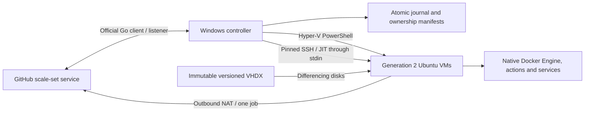
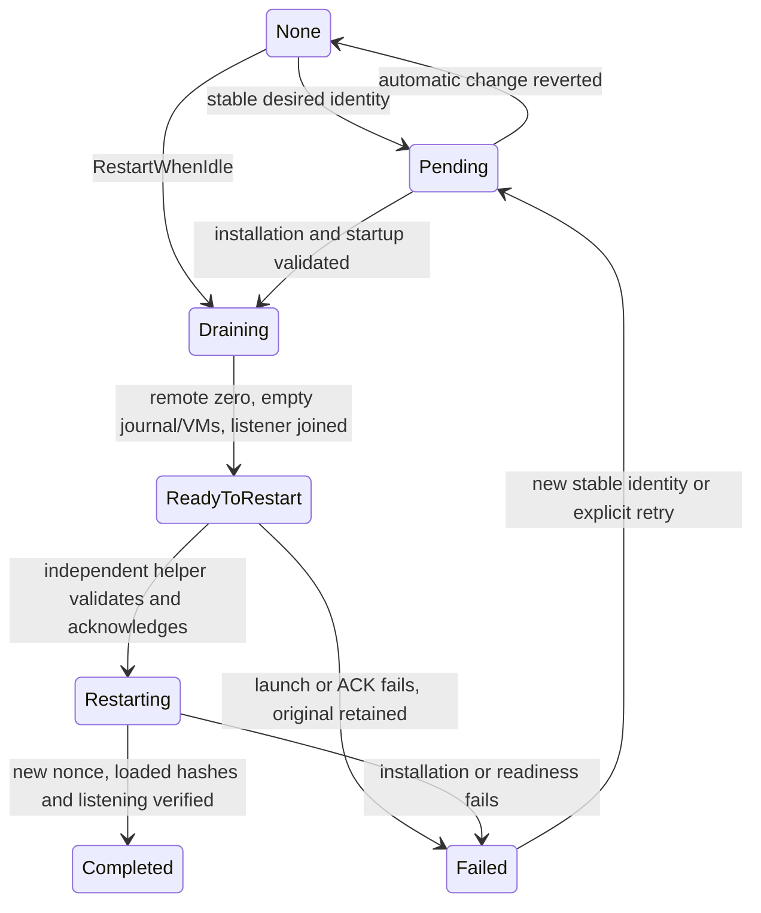

# Design

## Architecture and retained integration

`github.com/actions/scaleset` v0.5.0 remains responsible for authentication,
message sessions, polling, job acquisition, message IDs and acknowledgment.
`internal/github` retains exact group/scale-set reconciliation, additive optional
repository grants and the server's busy-runner deletion fence. Shutdown never
deletes the scale set. No second autoscaler or management daemon is introduced.

`internal/controller` remains the official listener's `Scaler`. Demand is
`min(maximum, minimum + TotalAssignedJobs)`, rather than event-message count.
The default configuration has minimum zero and maximum three. Both listener
callbacks and reconciliation serialize through one mutex; data, scale-set and
management file locks fence processes and offline operations. Guest boot happens
across ticks, so it does not hold the listener waiting for an entire VM boot.
Statistics expire, disconnection disables provisioning, and cleanup refreshes
demand before replenishment. The existing acquisition/ACK/replay tests remain.

The listener reports the configured **total maximum** through
`X-ScaleSetMaxCapacity`, including when some or all slots are busy. Available
slots are a separate local status value. A successful poll records the reported
maximum and timestamp; disconnected/stale status never claims live advertising.
Before obtaining JIT credentials, the controller records assigned vCPUs and checks
Windows memory, Hyper-V allocatable memory when available, and disk admission.
vCPU overcommit is allowed; assigned CPUs do not reserve physical cores. Resource shortages
retain assigned demand and the listener, with bounded exponential retry delays.
VM creation repeats admission to cover changes after JIT generation; durable
partial-failure cleanup and the server's busy-runner fence still apply.
CPU/RAM/concurrency are configuration inputs, not image provisioning inputs or
deployment ownership identity. An existing VM retains its original allocation.

The default logical disk and disk-growth admission budget are both 20 GiB.
Explicit earlier disk allocations remain valid, and changing logical disk size
changes image provisioning inputs. Top-level `storageRoot` bases relative data,
log, PAT and image paths on one folder; it defaults to the configuration file's
directory. Repository script/recipe paths stay relative to the configuration,
and absolute storage overrides are preserved. Effective recovery snapshots store
resolved paths, so a later root edit does not redirect recovery of old resources.

## Nested Hyper-V and network

Windows is the Hyper-V host for the Ubuntu VMs. When Windows is itself a
Hyper-V guest, nested extensions must already be exposed by its outer host;
these tools never alter the outer host. Windows CPU WMI flags can report false
with a hypervisor present and are not proof that nesting is unavailable or works.
Only an actual Ubuntu VM boot provides that evidence.

Use a dedicated **internal** switch and WinNAT inside Windows. Microsoft
documents [NAT for nested VMs](https://learn.microsoft.com/en-us/windows-server/virtualization/hyper-v/enable-nested-virtualization),
avoiding outer-switch changes and MAC spoofing. WinNAT supports one internal
prefix and does not provide DHCP; see its
[NAT requirements and limitations](https://learn.microsoft.com/en-us/windows-server/virtualization/hyper-v/setup-nat-network).
An incompatible existing NAT causes an actionable failure, never deletion or
reconfiguration. Existing switches, IPv4 routes (including WSL/HNS/VPN networks)
and gateway addresses are checked for conflict.

`network.json` journals a random owner and intended configuration before switch
creation. The internal switch carries exact ownership notes and its GUID is
saved. Repeated preparation checks this identity, subnet and NAT; it never adopts
a similarly named foreign switch. Existing conflicting resources are preserved.
There are no inbound NAT mappings or physical-LAN bridged guest NICs.

An explicit pre-activation `Reset-RunnerPreparation.ps1` removes an unused owned
network and its preparation records. It can recover from a missing checkout by
verifying the switch's runner ownership marker and the configured NAT prefix.
Attached VMs, active controllers/startup tasks, activated storage, foreign resources
and unexpected NAT mappings prevent reset. Metadata is removed only after both
network resources are gone, allowing retry after a partial removal failure.

NoCloud supplies each guest's static IP, gateway, DNS and MAC match. Allocation
comes from a configurable range and persists in each VM manifest until cleanup
completes. MACs derive uniquely from allocated addresses. Hyper-V MAC spoofing is
off and DHCP/router guards are on. The controller reaches SSH over the internal
switch. Native Docker publishes ports into the guest's network namespace;
`localhost:1433` in a workflow step therefore reaches that VM's SQL container.

Each owned VM adapter receives extended port ACLs before the VM can boot,
including image builders and validation clones. Public IPv4 traffic is allowed
only for the allocated guest IP; private, shared, link-local, loopback,
this-network, multicast and reserved IPv4 ranges and all IPv6 are blocked on the
adapter. A higher-priority stateful inbound rule permits controller SSH from the
configured gateway to guest port 22 and allows that session's replies through the
outbound private-address blocks. No stateless gateway or source-port exception
is installed. The complete installed policy, switch, MAC and guards are checked
again before starting a stopped VM; a partial or changed policy prevents boot.
Existing running VMs are drained and recreated to adopt the policy. These host
rules do not change the image provisioning fingerprint. See
[operations](operations.md#runner-network-restrictions) for ranges and checks.

## Automated image pipeline

The source is Canonical's **general-purpose Noble amd64 QCOW2**. Canonical
[explicitly excludes Azure VHDs from on-premises Hyper-V use](https://ubuntu.com/docs/public-images/public-images-reference/artifacts/).
The builder downloads SHA256SUMS and the image over HTTPS, compares SHA256, and
records the exact source hash. `sourceSha256` can pin it independently. QEMU's
Windows distribution is acquired through WinGet's pinned, hash-verified manifest;
[QEMU identifies its Windows distributor](https://www.qemu.org/download/#windows).
QEMU is an image-build utility, not the runner hypervisor or a runtime dependency.

The builder converts QCOW2 to dynamic VHDX, resizes it before provisioning,
creates a temporary Generation 2 VM and attaches a NoCloud ISO. The small Go
ISO9660/Joliet writer needs no WSL, COM image authoring or third-party ISO tool.
[NoCloud](https://docs.cloud-init.io/en/latest/reference/datasources/nocloud.html)
uses `CIDATA` and exact `user-data`, `meta-data`, `network-config` root files.
Linux Secure Boot uses `MicrosoftUEFICertificateAuthority`; configuration can
disable Secure Boot for a host where that template is unsupported.

Embedded guest scripts install the official runner (archive hash pinned), native
[Docker Engine/CLI/Compose/Buildx](https://docs.docker.com/engine/install/ubuntu/),
.NET 10 SDK from Ubuntu's feed, PowerShell 7 from Microsoft's feed, official Node
24 (verified checksum), Python, Git, build utilities and Playwright 1.62.1 system
dependencies. Setup actions can select additional SDKs/Node versions. This is a
focused runner image, not a copy of every GitHub-hosted tool.

The image is smoke-tested, then sealed: registration files are forbidden, SSH
keys/authorized keys, cloud-init cache/seed, machine ID, random seed, temporary
files and runtime markers are cleared. A clean guest poweroff is required.
Next, a **new differencing clone** with unique SSH/network identities must boot,
receive a different machine ID, initialize its runner service and pass Docker
smoke tests. Only then is a read-only base VHDX and validation metadata published
through an atomic `current.json` replacement. Failures preserve the previous
current image. Build logs and resolved package versions are archived separately.

Image IDs are VHDX hashes. Inputs include recipe, guest scripts and logical disk
size. Unchanged activation reuses a verified image. Apt repositories and the
default rolling Canonical URL resolve current content on a forced rebuild;
builds record their inputs and do not claim byte-for-byte apt reproducibility.
Pruning checks all registered VM disk parent chains and durable intents. Current,
newest validated images and referenced parents survive. Incomplete candidates
need matching ownership intent and only known files before cleanup is allowed.

## Per-job lifecycle and recovery

1. Journal the unique runner name before the official JIT API call.
2. Keep returned JIT only in memory; persist the GitHub runner ID separately.
3. Record assigned CPUs and check available memory and configured per-VM
   disk-growth budgets plus the Windows disk reserve.
4. Write a VM ownership intent before creating keys, seed, disk or VM.
5. Create the differencing VHDX and Generation 2 VM with static RAM/CPU, disabled
   checkpoints and no automatic start/save-state behavior.
6. On guest readiness, detach/delete seed media and send JIT over pinned SSH stdin
   to a private, atomically published guest file. Never put JIT in command args,
   user-data, operational JSON or the journal.
7. The non-root runner consumes/unlinks JIT, launches the listener once and clears
   the wrapper environment. Online state requires the listener's ready message;
   job hooks and GitHub events identify busy/completed jobs.
8. After listener exit, reconcile the exact registration, archive redacted logs,
   stop/remove the exact owned VM, revoke its parent-disk ACL, delete its files,
   release allocation, then remove the journal entry.

Each manifest stores deployment owner, scale, nonce, purpose, VM GUID/security
identity, image parent, IP/MAC and exact directory. Hyper-V notes, configuration
path and attached disk must agree. A name prefix alone never authorizes deletion.
A lost create reply is recoverable through the durable intent, ownership notes
and exact disk/configuration paths. Corrupt or missing identity fails closed.
Reparse points are refused during file deletion.

Restart adopts existing jobs rather than blindly replacing VMs. Starting guests
get their startup grace; a process restart loses undelivered JIT and retires that
attempt through GitHub's busy fence after its deadline. A failed probe never
establishes idleness. Busy jobs survive draining, reduced demand and controller
reconnection. Cancellation/failure/completion uses the same cleanup path.
An offline guest can prevent log retrieval; cleanup records that limitation and
still removes its private disks. Cleanup failures retain ownership for retry.
Abandoned image/validation VMs are recoverable because they cannot contain jobs.

Runtime bridge scripts are copied to a hash-named private snapshot so editing
source does not change the implementation managing an active job. Activation
fingerprints configuration, credential blob, binary, bridge and image before
deciding whether an unchanged healthy process can be reused.

## Security, migration and boundaries

Administrator-session account setup uses a hidden credential-backed PowerShell
process with the target user's Windows profile loaded. Password/PAT exchange uses
inherited process pipes; requests are bound to an in-memory per-run channel ID.
The worker verifies its SID and non-admin token before reading credentials, stores
its own CurrentUser DPAPI PAT and runs normal activation and session-0 validation.
Only boot-task registration crosses back to the administrator: the parent builds
the fixed controller action, account and `Limited` principal itself, checks existing
task ownership, and grants that user task access. Worker-supplied task definitions
and arbitrary privileged commands are never executed. The worker verifies the
registered task before starting it. A non-secret receipt outside private runtime
directories permits retries without changing their account/SYSTEM ACLs.

The PAT remains Windows CurrentUser DPAPI, usable only by its Windows account and
machine. Private host directories allow that account and SYSTEM; individual VM
accounts get the disk/seed access they require. Guests receive no PAT, host
workspace bind mounts or host Docker socket. Password SSH and root SSH are off;
each VM has a fresh pinned host key and private controller key. Logs are bounded
and redacted. The runner has passwordless sudo and Docker access within its
disposable VM, as conventional workflows require.

NAT and adapter ACLs do not establish hostile-tenant isolation. Private/local
destinations are blocked, but publicly addressed internal services can remain
reachable. Use trusted organization workflows and
existing Windows firewall policy. Hyper-V Administrators have broad host rights;
[Microsoft supports this group for VM management](https://learn.microsoft.com/en-us/windows-server/virtualization/hyper-v/get-started/create-a-virtual-machine-in-hyper-v).
Membership alone does not establish every local policy/ACL permission: the
clone and scheduled-task probes must pass on the actual host at the configured
startup run level. The default is `Limited`; temporary `Highest` diagnostics
require local administrator membership and fresh validation when reverting.

An empty legacy journal migrates once to version 2, preserving owner and scale-set
ID, with exact configuration/state backups. Nonempty legacy state is refused.
The one-time migration inspects available legacy ownership without deleting
containers or installations. Compatible GitHub/controller settings and the PAT
are preserved. No WSLC provisioning backend remains. Startup registration is
revalidated for Hyper-V; S4U denial remains an explicit failure stage. Password
startup uses a credential-backed Task Scheduler batch logon under the same SID,
preserving CurrentUser DPAPI without an interactive sign-in session. Its temporary
probe must decrypt the saved PAT and validate a restricted clone in session 0
with an administrator token only when `Highest` startup is configured.
Only this mode's fingerprint is independent of boot/session; it instead binds
machine identity and the saved PAT hash. Registration and subsequent starts use
the same task, and graceful handoff restarts it without asking for credentials.
The Windows password is supplied in memory to Task Scheduler, never in a
subprocess argument or a controller configuration/report. Cold boot,
live nested Hyper-V and full-workflow acceptance require the evidence described in
[validation](validation.md).

## Restart coordination

The pre-change protocol and lifecycle audit is in [restart-audit.md](restart-audit.md).
`internal/restart` fingerprints prepared artifacts and persists the handoff;
runner ownership stays in `internal/controller`. Acquisition intents extend the
v2 journal to cover work without a VM. The existing listener callback and
reconciler remain the only provisioning/cleanup path and share their mutex.

The controller never exits merely because it is idle. Its final barrier joins
the official listener's callback/ACK/session close and rechecks ownership under
the engine mutex. Filesystem control remains nonce-protected and account-local.
The one-shot PowerShell helper reuses existing management/data/scope locks and
installation/startup functions. Native Job Object escape is verified before
execution; the existing WMI broker provides an independent fallback. Actual
helper-token access is validated before the original can exit. No additional
startup task or permanent process is introduced. See
[operations](operations.md#automatic-graceful-restart) for validation boundaries,
failure recovery and the first upgrade from an older controller.
